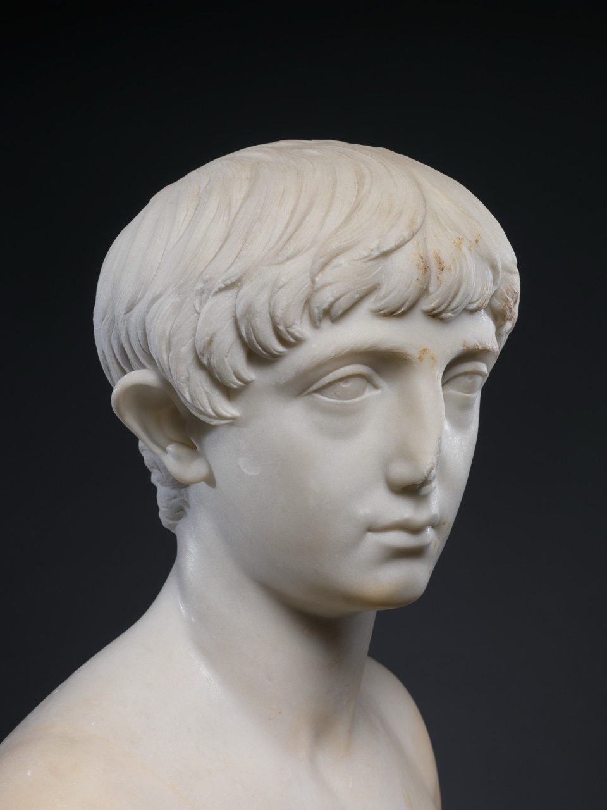
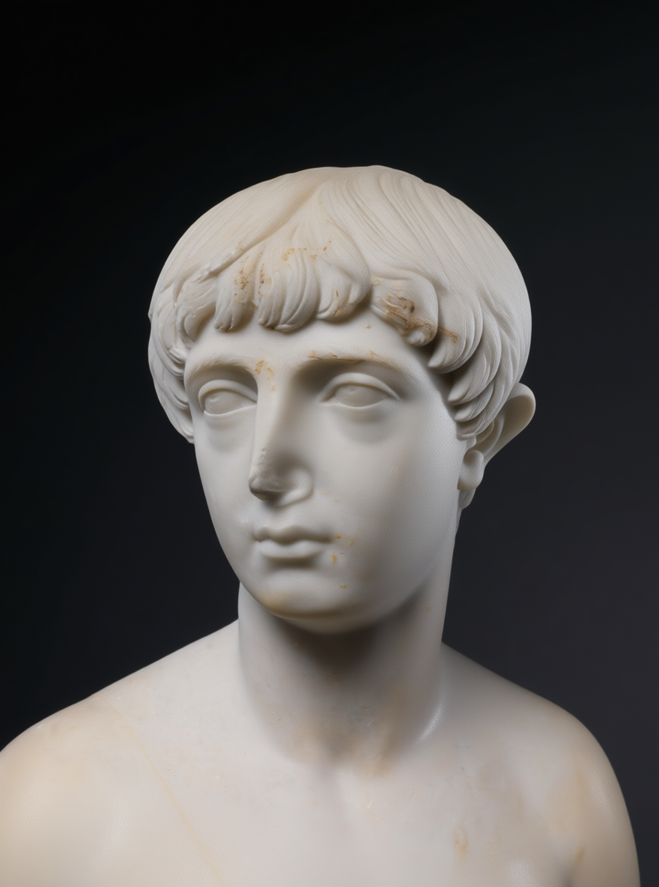
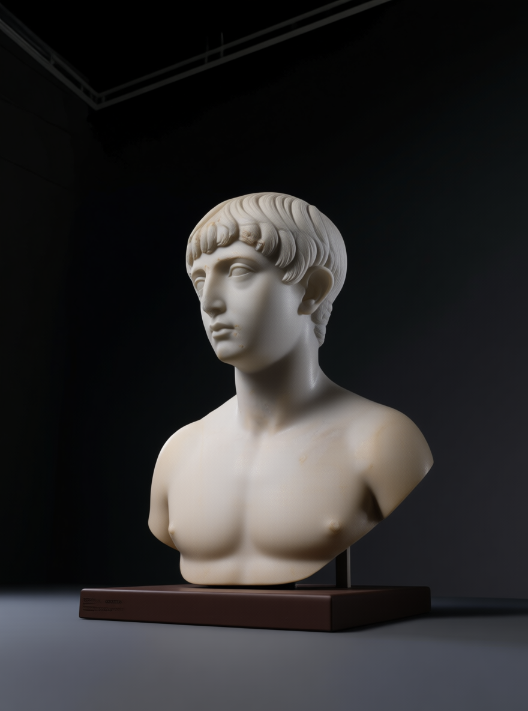
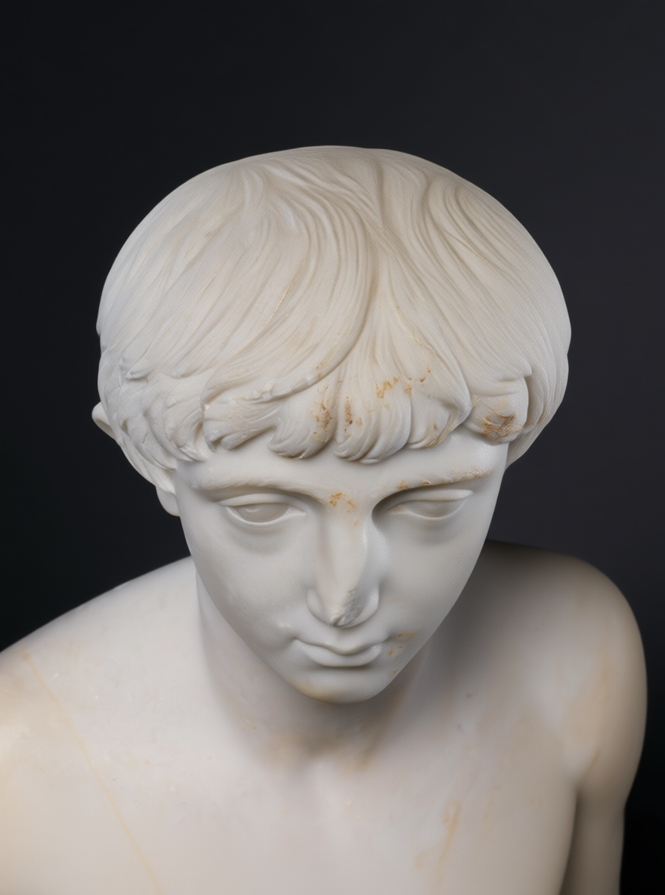

# Open Higgsfield — Reshoot

**A virtual film set for any photo.** Drop in a subject, drag a camera anywhere around it in 3D, preview the move on a live monitor, then shoot it: a new angle with Qwen-Image-Edit and a cinematic camera move with LTX. All of it runs on open-weight models through the Comfy Developer Platform.

**▶ Try it: [open-higgsfield-reshoot.vercel.app](https://open-higgsfield-reshoot.vercel.app)** (the public demo runs in dry-run mode: the full set, monitor and workflow compiler, with no GPU attached).

Built for the [#OpenSourceHiggsfield](https://comfy.org/open-source-higgsfield) challenge. It rebuilds Higgsfield's two headline apps, **Angles** (re-shoot a subject from any angle) and **Cinema Studio** (direct the camera like on a film set), as one open, inspectable app.

| Source | Re-shot: front-left | Low angle, wide | High angle, close |
|---|---|---|---|
|  |  |  |  |

<sub>Real, unedited outputs of the angle stage, rendered locally on an M1 Max. Subject: <i>Marble bust of a youth</i>, The Met Open Access (CC0). See <a href="examples/angles/">examples/angles</a>.</sub>

## What it does

| | |
|---|---|
| **The set** | A 3D stage with your subject standing in it. Drag the amber camera around (360° azimuth, low to overhead) or click any of the 96 marks the angle model was trained on. Snaps to the nearest pose on release. |
| **The monitor** | A live viewfinder showing what that camera sees, with the lens, aspect frame lines and colour grade applied. The chosen camera move plays on a loop (including a true FOV-compensated dolly zoom), so you can block the shot before spending a GPU-second. |
| **Director's panel** | 15 camera moves (7 driven by official LTX camera-control LoRAs), 6 lenses, 8 colour grades, aspect, duration and an action line. |
| **Outputs** | **Still** (new angle), **Shot** (new angle, then video move) or **Coverage** (one click shoots a pack of angles: dialogue coverage, hero product, 360° turnaround or the best 12). |
| **Dry run** | No GPU? Rolling compiles the *exact* ComfyUI workflow for that shot so you can download it and run it in ComfyUI yourself. Nothing is hidden. |

## How it works

```
Browser (Next.js + three.js)            Server routes                     Comfy Developer Platform
──────────────────────────────          ─────────────────────             ─────────────────────────────
3D rig → ShotSpec ───────────────────▶ /api/generate                       Comfy Cloud  (COMFY_API_KEY)
                                         compile ShotSpec → API workflow ─▶ or serverless deployment
                                         @comfyorg/sdk submit              or local ComfyUI via
poll /api/jobs/:id ◀──────────────────  job status / progress               comfy-api-proxy (COMFY_BASE_URL)
angle done → chain "move" job ───────▶  output → asset → move workflow
<video> ◀──────────────────────────────  signed download URL / stream
```

* **[`workflows/`](workflows/)** is the source of truth: API-format graphs, editor-format copies in `workflows/ui/`, and `manifest.json`, which maps friendly inputs (`prompt`, `seed`, `cameraLora`…) to graph nodes and lists every model with its licence and download URL. Core ComfyUI nodes only; no custom node packs and no partner/API nodes.
* **Angle stage:** Qwen-Image-Edit-2511 + the [Multiple-Angles LoRA](https://huggingface.co/fal/Qwen-Image-Edit-2511-Multiple-Angles-LoRA) (8 azimuths × 4 elevations × 3 distances = 96 poses) + Lightning 4-step LoRA.
* **Move stage:** LTX-2 19B image-to-video with Lightricks' official camera-control LoRAs (dolly, truck, jib, static) and prompt-driven orbit, pan, tilt, handheld and dolly zoom.
* **Experimental:** `reshoot.api.json` re-films an existing *video* from a new angle with an LTX-2.3 CrossView IC-LoRA.
* The web app is stateless. Jobs live in Comfy, so it deploys to any serverless host.

### How we used REA

We pointed [REA](https://github.com/morluto/rea), an open-source reverse-engineering toolkit, at Higgsfield's **public, logged-out** web app to map the feature surface: the camera-move catalogue, optics, aspect and duration ranges, and the Angles pose grid (which turned out to be the same 8 × 4 × 3 grid as the open Multiple-Angles LoRA). We then rebuilt that behaviour from scratch on ComfyUI. No Higgsfield code, prompts or assets are in this repo. See [`research/how-rea-was-used.md`](research/how-rea-was-used.md) and [`research/higgsfield-feature-map.md`](research/higgsfield-feature-map.md).

## Run it

Requirements: Node 22+. Plus one of the engines below (or none, for dry-run mode).

```bash
git clone https://github.com/pyoonpyoon/open-higgsfield && cd open-higgsfield/web
npm install
npm run dev        # http://localhost:3000
```

With no configuration the app runs in **dry-run** mode. Configure an engine with environment variables (for local development, put them in `web/.env.local`):

| Variable | Purpose |
|---|---|
| `COMFY_API_KEY` | Run on **Comfy Cloud** (key from platform.comfy.org → API keys). |
| `COMFY_BASE_URL` | Run on a **serverless deployment** (with `COMFY_API_KEY`), or on a **local ComfyUI** behind `comfy-api-proxy` (without a key). |
| `COMFY_WORKFLOW_VARIANT` | Optional. `gguf` swaps the angle model for a Q8_0 GGUF (about 22 GB instead of 41 GB). Needed on Apple Silicon. |
| `APP_ACCESS_CODE` | Optional. Visitors must enter this code before real jobs run (protects your credits on a public deploy). |
| `RATE_LIMIT_PER_HOUR` | Optional. Jobs per IP per hour, default 30. |

### Engine A: Comfy Cloud
Set `COMFY_API_KEY` and restart. The model files named in `workflows/manifest.json` must be available in your Cloud workspace.

### Engine B: your own ComfyUI (fully local, open weights)
```bash
# 1. ComfyUI (Comfy-Org/ComfyUI) + comfy-api-proxy in one venv, then:
scripts/local-stack.sh start          # ComfyUI :8188, proxy :8189
# 2. Weights: NVIDIA ≥48 GB uses bf16 (≈59 GB); Apple Silicon / smaller GPUs use the GGUF variant (≈40 GB)
scripts/fetch-models.sh angle            # or: scripts/fetch-models.sh angle:gguf
# 3. Point the app at the proxy
COMFY_BASE_URL=http://127.0.0.1:8189 npm run dev
#    (Apple Silicon: COMFY_BASE_URL=http://127.0.0.1:8189 COMFY_WORKFLOW_VARIANT=gguf npm run dev)
```

**Apple Silicon notes** (tested on an M1 Max with 64 GB):
* Install [ComfyUI-GGUF](https://github.com/city96/ComfyUI-GGUF) into `custom_nodes/` and `pip install gguf`.
* The bf16 model plus text encoder exceeds 64 GB of unified memory, and macOS kills the process (exit 137). The Q8_0 GGUF fits.
* MPS has no float8, and the int8 "convrot" file needs CUDA kernels, so don't use those weights on a Mac.
* `scripts/local-stack.sh` starts ComfyUI with `--fast-disk --cache-none --reserve-vram 12` on macOS.

### Deploy (Vercel)
Set the project root to `web/`, add the variables above, and deploy. The home page is prerendered, so **redeploy after changing `COMFY_API_KEY`** for the engine badge to update.

## Development

```bash
cd web
npm test                                # shot compiler + workflow binding tests
npm run typecheck && npm run lint
node ../scripts/validate-workflows.mjs  # checks every graph against ComfyUI's object_info
```

## Licences

* Code: [MIT](LICENSE).
* Models are downloaded separately under their own licences. Qwen-Image-Edit-2511, the Multiple-Angles LoRA and the Lightning LoRA are Apache-2.0. LTX-2 is under the LTX-2 Community License. Full table in [`workflows/README.md`](workflows/README.md).
* Example subject: *Marble bust of a youth*, The Metropolitan Museum of Art, Open Access (CC0).
